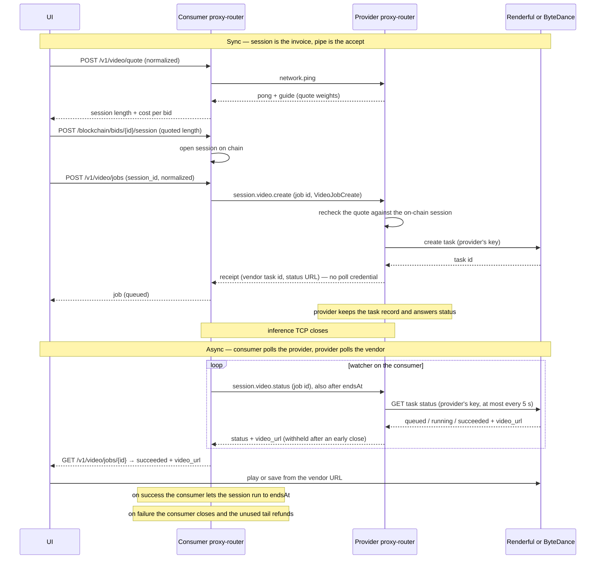

# Video jobs — architecture

**Status:** design, implementation in progress. Tracks [Morpheus-Lumerin-Node #957](https://github.com/MorpheusAIs/Morpheus-Lumerin-Node/issues/957). The 2026-10-20 proposal is in that issue; the 2026-10-29 implementation update from @alex-sandrk changed the flow as described in §0.
**Last updated:** 2026-10-29
**Scope:** proxy-router first (provider and consumer). Any UI, including MorpheusUI, is a client of the consumer node's local API. The hosted gateway (`api.mor.org`) is out of scope until the node path exists.

A video model accepts a prompt and starts a render at a hosted vendor. The receipt comes back on the session with the vendor task id. The provider keeps the task record and answers status for the life of the job; the consumer polls the provider, and the provider polls the vendor with its own key. The session clock is the invoice. The bytes never sit on the provider.

---

## 0. Changes from the proposal

| Proposal (2026-10-20) | Implementation (2026-10-29) | Why |
|---|---|---|
| Receipt carried `status_url` + `poll_auth`; consumer polled the vendor; provider was done after the receipt | Receipt carries no credential. Provider keeps the task record and answers `session.video.status`; consumer polls the provider | Neither vendor has a read-only key (BytePlus scopes by project/model/IP, Renderful has no scopes), so `poll_auth` would have been the provider's account key. Even a read-only key would let a consumer close early, take the refund, and still fetch the clip from the vendor |
| Video job as a request kind on `session.prompt` | Dedicated `session.video.create` and `session.video.status` methods | A typed payload on `session.prompt` falls through to the chat path on an older provider |
| Provider checked the quote against time left in the session | Provider checks the quote against the on-chain session length `endsAt − openedAt`; refuses closed sessions | "Time left" let a 300 s session buy a 420 s job; a closed session let a consumer open, close for the refund, then order |
| Early close refunds unused time; vendor status URL still works for the user | Early close (>60 s before `endsAt`) forfeits the clip: status answers `cancelled`, `video_url` withheld | The refund or the clip, never both |
| `POST /v1/video/jobs` opened the session | Caller quotes (`POST /v1/video/quote`), opens (`POST /blockchain/bids/{id}/session`), then submits with `session_id` | Opening is a wallet action; the caller sees the quote and stake before committing |

The rest of this document describes the implemented flow.

---

## 1. What we are building

Two products get a Morpheus bid first:

| Vendor | API | Create | Later |
|---|---|---|---|
| **Renderful** | `https://api.renderful.ai/api/v1` | `POST /generations` returns a task id | `GET /generations/{id}` → `outputs[]` URL when `completed` |
| **ByteDance** (BytePlus ModelArk, international) | `https://ark.ap-southeast.bytepluses.com/api/v3` | `POST /contents/generations/tasks` returns a `cgt-…` id | `GET /contents/generations/tasks/{id}` → `content.video_url` when `succeeded` |

Both accept text, or text plus a first-frame image, plus clip length, aspect, resolution, and an audio flag. Both return the id immediately and publish an MP4 URL about a minute to a few minutes later. That URL is valid for about 24 hours. A Dreamina Seedance 2.5 URL also stops after 100 downloads. Task records on BytePlus stay queryable for 7 days.

The China Volcengine host is a different base URL and different model ids. A BytePlus key does not call it. This design uses the international API only.

Prodia stays what it is. `prodia-v2` blocks until the vendor returns `video/mp4` bytes and the router base64s them into one `videoRawContent` chunk. That fits a short clip that comes back in the POST body. It is the wrong shape for these jobs, and this design does not route them through it.

---

## 2. Two clocks



**Session clock.** Wall time from `openSession` to `min(closedAt, endsAt)`, priced at the bid's `pricePerSecond`. The provider is paid for that interval at close, from the protocol funding account on a normal session (`directPayment` changes who pays, not the formula). An idle open session still counts. The on-chain session stays open for the quoted length because that length *is* the price of the clip. Holding it open is the consumer's close call.

**Delivery clock.** Render time. The consumer asks the provider for status; the provider reads the vendor. A 10-second clip often finishes in one to three minutes. The MP4 URL is in the status answer once the vendor marks the task succeeded and the session was not closed early.

---

## 3. Normalization

Vendors differ in field names, status words, and where the URL sits. Callers do not.

The consumer, every UI, and every future client speak one document, `VideoJobCreate` in and `VideoJob` out. Each vendor is an `apiType` adapter on the provider, the same way `prodia-v2` and `hyperbolic-sd` are adapters today. A new text-to-video host is a new adapter behind the same documents.

### 3.1 On-chain tag

One modality tag: `video`.

`DetectModelType` on `dev` has no video type. The strings `video`, `text2video`, `text-to-video`, and `t2v` are recognised only by the health checker, which skips the LLM probe and reports `skipped`. The rest of the router treats the model as unknown and sends a chat completion. That is the #957 gap.

`video` (and those aliases) becomes a real model type. It selects the video job path on the consumer and the provider. The health checker keeps skipping the arithmetic probe. A video bid is not sent a chat completion.

Vendor names stay off the chain. A `renderful` tag and a `bytedance` tag would make every client branch on the host, and the next vendor would add another tag. The host is the provider's `apiType`. The marketplace shows a model name (`Seedance 2.5`, `Wan 2.6`) and the tag `video`.

`tee` on a video model means the usual node attestation. The render itself runs at Renderful or ByteDance. Attestation covers the proxy-router. It does not cover the vendor GPU.

### 3.2 Provider `apiType`

| `apiType` | Speaks |
|---|---|
| `renderful` | Renderful generations API. Auth `Bearer`. Model id and default type (`text-to-video`, `image-to-video`) live in `models-config.json` `parameters`. |
| `byteplus-video` | BytePlus ModelArk content-generation tasks. Auth `Bearer` Ark key. Model id such as `dreamina-seedance-2-5-260628` in `parameters`. |

`apiUrl` and `apiKey` are the existing models-config fields. The create call and every status read use the provider's key. The key never leaves the provider.

Adding Kling, Wan, Veo, Runway, Luma, or Hailuo later is another row in this table. See §10.

### 3.3 The job document

Submit (`POST /v1/video/jobs`, `session_id` header required):

```json
{
  "model": "0x…",
  "prompt": "A girl holding a fox, the camera slowly pulls back, wind in her hair.",
  "duration_seconds": 5,
  "aspect_ratio": "16:9",
  "resolution": "720p",
  "generate_audio": true,
  "image_url": "https://… or omitted",
  "image_b64": "omitted when image_url is set"
}
```

`model` is the on-chain model id. Everything else is optional except `prompt`. Omitted fields take the guide's defaults (§8). The receipt echoes the resolved values so the caller can see what was assumed.

Receipt, returned on the sync call:

```json
{
  "object": "video.job",
  "id": "job_…",
  "model": "0x…",
  "status": "queued",
  "session_id": "0x…",
  "quote_seconds": 300,
  "vendor_task_id": "cgt-… or gen_…",
  "status_url": "https://vendor.example/…/tasks/cgt-…",
  "resolved": {
    "prompt": "…",
    "duration_seconds": 5,
    "aspect_ratio": "16:9",
    "resolution": "720p",
    "generate_audio": true
  }
}
```

`id` is the consumer's job id, sent on `session.video.create` and used on every `session.video.status`. `vendor_task_id` and `status_url` are informational: both vendors require the account API key on the status GET, so the consumer cannot use them directly and is not meant to. Status comes from the provider (§6).

Later poll on the consumer:

```json
{
  "object": "video.job",
  "id": "job_…",
  "status": "succeeded",
  "video_url": "https://vendor.example/…/file.mp4",
  "expires_at": "2026-10-21T21:54:00Z",
  "error": null
}
```

`video_url` is the URL the vendor put on the succeeded task, relayed by the provider in the status answer. The provider does not download the MP4.

Status values on the Morpheus job, regardless of vendor vocabulary:

| Morpheus | Renderful | ByteDance | Also |
|---|---|---|---|
| `queued` | `queued` | `queued` | |
| `running` | `processing` | `running` | |
| `succeeded` | `completed` | `succeeded` | |
| `failed` | `failed` | `failed` | |
| `expired` | — | `expired` | |
| `cancelled` | — | `cancelled` | provider answer after an early close (`session_closed_early`) |

`failed` is terminal at the vendor. A retry is a new job and a new session.

---

## 4. Pricing and economics

The contract already prices time. A video job borrows that. One session is one video. The session length is a function of the clip that was asked for, and `pricePerSecond × session length` is the price of the render.

This is an analog of renderer work, not of render latency. A clip that takes 90 seconds of GPU and a quote of 300 session-seconds still pays for 300 seconds. The link can arrive at second 90. The session still runs to its end on success.

### 4.1 What the chain actually does

From [Sessions: stake, close, claim](https://nodedocs.mor.org/concepts/sessions-stake-close-recover):

- `openSession` escrows stake. It does not spend it.
- Used amount is wall-clock session time × `pricePerSecond`, with `sessionEnd = min(closedAt, endsAt)`.
- Unused stake returns in the close transaction. Used stipend day-locks until the next UTC day.
- The provider is paid at close for the time used.
- Stake pulled from the wallet is not `pricePerSecond × duration`. The router computes `stake = ceil(supply × pricePerSecond × (duration + 1) ÷ todaysBudget)`. The supply-to-budget ratio is several hundred, so the wallet locks much more MOR than the session's compute value. All of it returns except the day-locked used slice.
- The contract minimum is 300 seconds. `GET /blockchain/sessions/duration` returns the live min and max. The documented sample response is `min_seconds: 300`, `max_seconds: 86400`.

Closing when the receipt arrives refunds almost the whole quote and underpays the render. The client that wants the video leaves the session open through `endsAt`; §4.4 is what happens if it does not.

### 4.2 The quote

The provider publishes `pricePerSecond` on the bid. That is the rate for the cheapest clip it is willing to sell, because every open is at least 300 seconds.

The provider also publishes weights in `models-config.json` `parameters`, surfaced in the guide (§8) so the consumer can quote before open:

```
work = clipSeconds
     × resolutionWeight[resolution]
     × audioWeight[generate_audio]
     × imageWeight[image present]

sessionSeconds = clamp(ceil(work × secondsPerWorkUnit), minSession, maxSession)
```

`secondsPerWorkUnit` is chosen so `pricePerSecond × sessionSeconds` covers the vendor invoice for that shape of clip, plus the provider's margin. The weights are per model, because Seedance 2.5 at 720p is not Wan at 480p.

Illustration only, using Renderful's published Seedance 2.5 card (about $0.14/s at 480p and $0.315/s at 720p). It is not a MOR price. MOR conversion is whatever `pricePerSecond` the provider posts that day.

| Clip | Vendor shape | Relative work |
|---|---|---|
| 4s, 480p, no audio, text only | cheapest | 1× — this is the 300s floor |
| 10s, 720p, audio, text only | mid | several times the floor |
| 30s, 720p, audio, plus a first frame | heavy | longest quote on this bid |

Set `pricePerSecond` so `300 × pricePerSecond` matches the cheapest row. Heavier rows extend `sessionSeconds`. A request whose quote would exceed `maxSession` is rejected before the vendor is called. The most expensive clip one bid can sell is `pricePerSecond × maxSession`.

`POST /v1/video/quote` on the consumer pings each bid's provider, reads the guide weights off the pong, and returns session length and cost per bid with the contract min/max applied. A provider without a guide (older build) is listed with an error and no session length. The caller then asks `GET /blockchain/models/:id/session/estimate?sessionDuration=<quote>` for the stake, and opens.

### 4.3 Who enforces it

The caller opens the session for the quoted length. The provider recomputes the quote from its own weights and checks it against the **on-chain** session, not the consumer's claim:

- Session length is `endsAt − openedAt` from the chain, with a 10 s tolerance for stake rounding. Time remaining is only a fallback when the chain record carries no timestamps.
- A session already closed on chain is refused.
- The chain read is tried 3 times. If it still fails, the job is refused; the cached session cannot show a close.
- If the quote does not fit, the provider returns an error naming the duration that would have been accepted, and does not call the vendor.

One job per session. `session.video.create` carries the consumer's job id. A resend with the same job id returns the same receipt and starts no second vendor task. A different job id on the same session is refused. That keeps "this session's length" equal to "this clip's price" without leftover-time arithmetic.

### 4.4 Success, failure, early close

| Outcome | Session | Clip |
|---|---|---|
| Vendor `succeeded` | Consumer leaves it open until `endsAt`. That is the payment. | `video_url` arrives in the status answer. |
| Vendor `failed`, `expired`, or `cancelled` | Consumer closes now. Unused tail refunds. | None. |
| Consumer closes more than 60 s before `endsAt` | Unused tail refunds. Provider is paid only for the seconds used. | Forfeited. The status relay answers `cancelled` (`session_closed_early`) without `video_url`. A clip that arrives while the close is being mined is dropped. |
| Consumer closes within 60 s of `endsAt` | Treated as the normal end. The consumer's own expiry close lands about a minute after `endsAt`. | Delivered. |

The refund or the clip, never both. The UI warns before an early close.

Day-lock still applies to the used slice. A provider who sells many video sessions should expect the consumer's MOR float to be the gross stake, not the compute value, and should expect that stake to sit until the next UTC day. Same rule as chat.

### 4.5 What the provider pays upstream

The vendor invoices the provider in dollars when the task is created or when it succeeds (vendor-specific). The Morpheus session pays the provider in MOR at close. Those are separate ledgers. The quote is how the provider lines them up.

**Known gap.** A close while the render is running still costs the provider the render. The provider sends no cancel: BytePlus can only cancel a queued task, and Renderful documents no cancel. The clip is withheld (§4.4), but the vendor bills it once it succeeds. The weights should assume this is rare, and the provider should not call the vendor until the on-chain session checks out (§4.3).

---

## 5. Sync path — accept the job

Three calls on the consumer, then one RPC to the provider.

1. The UI has a `VideoJobCreate`, either from a form or from defaults applied to a sentence.
2. `POST /v1/video/quote`. The consumer pings the bids' providers, reads each guide, and returns session length and cost per bid (§4.2).
3. `POST /blockchain/bids/{id}/session` for the quoted `session_seconds`. This is the existing open; the wallet signs it.
4. `POST /v1/video/jobs` with the `session_id` header. The consumer generates a job id and sends `session.video.create` on the session pipe.
5. The provider checks the on-chain session against its own quote (§4.3) and calls the vendor create endpoint with the provider's key.
6. The vendor returns a task id. The provider stores the task record (job id, vendor task id, session) and returns the receipt on the same RPC. No vendor credential is in it.
7. Both sides drop the TCP connection. The provider keeps the task record for 8 days (BytePlus keeps the task 7) and answers `session.video.status` from it.

`session.video.create` is a new MOR-RPC method, not a request kind on `session.prompt`. On an older provider it returns "unknown method" and starts no vendor task; a typed payload on `session.prompt` would have fallen through to the chat path.

The consumer's first-response budget is `CNODE_PNODE_TIMEOUT` (default 90s) times `CNODE_PNODE_MAX_RETRIES` (default 3). The receipt has to be the first bytes, well inside one attempt. The provider does not poll the vendor before answering.

A retried `session.video.create` with the same session and job id returns the existing receipt. It does not create a second vendor task. A silent provider plus the default retry would otherwise buy the clip twice.

A failed submit leaves the session open. The caller retries on it or closes it.

Input images are the one payload that is more than JSON. The vendor fetches a first frame from a URL it can reach. A file on the user's machine is not that URL. The submit may carry `image_b64` (size-capped) or `image_url` when the image is already public. The provider passes the bytes to the vendor's upload (Renderful `POST /uploads`) or places them where ByteDance can fetch them, puts the resulting URL into the vendor create call, and discards the bytes. The output MP4 is never handled this way.

Concurrency: the vendor queues or rejects. A create that the vendor refuses (429, capacity) fails the sync call; the caller closes the session so the unused quote returns.

---

## 6. Async path — the consumer polls the provider

The inference pipe is closed. The on-chain session may still be open, because that is the invoice, and only the consumer closes it. Status goes through the provider, which is the only party holding a vendor key.

### 6.1 `session.video.status`

New MOR-RPC method. The consumer sends the job id; the provider answers with the normalized status and, when the job has succeeded and the session was not closed early, `video_url` and expiry.

- Signed with the consumer's wallet key, like `session.prompt`. The answer is encrypted to the consumer and names the job it is for.
- No session-expiry gate, the same as `session.report`. It works after `endsAt`, because a render can outlive its session.
- The provider caches a running status for 5 s and a final one for 24 h. Polls on one session queue behind each other. However hard a consumer polls, it causes at most one vendor read per session every 5 s.
- The provider keeps the task record 8 days.
- The provider checks the on-chain close state before releasing `video_url` (§4.4).

### 6.2 Consumer watcher

The consumer proxy-router owns the watcher. When the receipt arrives it starts a poller for that job. The poller sends `session.video.status` to the provider. It does not open a session and does not touch the vendor.

Each answer is written to local job state. While the job is queued or running, `video_url` is absent. On success the record includes the vendor MP4 URL and the expiry. On failure it includes the vendor error. After an early close it reads `cancelled` with `session_closed_early`.

Poll cadence: a few seconds until a terminal status, then stop. Back off if the provider is unreachable. A consumer close stops the watcher (§4.4). The session reaching `endsAt` does not stop a watcher that is still waiting, and the provider still answers, so a render that outlives the quote can still deliver the link.

### 6.3 What the UI consumes

The UI talks only to the consumer node (`localhost` basic-auth, the same API MorpheusUI and any other front end already use). The `/v1/video/*` routes use the basic-auth method `video_jobs`.

| Call | Use |
|---|---|
| `POST /v1/video/quote` | Session length and cost per provider for a job, contract min/max applied |
| `GET /blockchain/models/{id}/session/estimate?sessionDuration=` | Stake to lock for that length (existing) |
| `POST /blockchain/bids/{id}/session` | Open the session for the quoted length (existing) |
| `POST /v1/video/jobs` | Submit on that session (`session_id` header, required) |
| `GET /v1/video/jobs`, `GET /v1/video/jobs/{id}` | Local job records; this is the async feed |
| `POST /v1/video/jobs/{id}/close` | Close early: refund the unused time, no clip |

A second UI on the same consumer sees the same job by id. Neither UI dials the provider or the vendor for status.

A consumer-side byte pull (`GET /v1/video/jobs/{id}/content`, streaming the vendor MP4 through the consumer so a remote UI never sees the bearer URL) was in the proposal and is not in the current implementation. The UI plays or saves `video_url` directly.

---

## 7. Privacy

Vendors cannot push to a consumer. Consumer nodes are behind NAT and have no inbound port. The provider pulls status from the vendor; the consumer pulls from the provider; the UI pulls from the consumer. Nobody is waiting on a webhook.

No vendor credential leaves the provider. `vendor_task_id` and `status_url` are on the receipt and on the local job record for reference; without the provider's key they are not usable. They are not written on chain and not put in the session report.

Status answers are encrypted to the consumer's key on the wire, like every other provider → consumer payload. The provider holds the task record, including `video_url` once known, for 8 days.

The MP4 URL is a bearer link. Anyone who has it can download the file until it expires or hits the download cap. The consumer learns it from the provider and shows it to the local caller because that caller is the user. It is not written on chain. Fetching `video_url` from the UI sends the user's address to the vendor and sends no Morpheus credential.

The prompt and the first-frame image leave the provider for the vendor during the accept. That is the same resale pattern as an OpenAI-compatible chat model.

---

## 8. Guide, JSON, and natural language

Renderful and ByteDance do not open a session with an agent that interviews the user. They publish parameter lists. Renderful's model pages and `GET /models` name the fields. BytePlus publishes a create-task reference and per-model tutorials. There is no MCP server on either side.

The proxy-router publishes the guide itself, as data, before anyone pays for a session. The provider returns it with the pong on `network.ping`, so `POST /v1/video/quote` reads it from every bid's provider without `openSession`. The consumer exposes it locally for whatever UI is attached. An older provider returns no guide; the quote lists that bid with an error.

The guide is the normalized schema plus the quote weights plus plain language, one per model:

```json
{
  "object": "video.guide",
  "model": "0x…",
  "model_name": "Seedance 2.5",
  "summary": "Text to video, or text plus one image as the first frame. Clip length 4–30 seconds.",
  "defaults": {
    "duration_seconds": 5,
    "aspect_ratio": "16:9",
    "resolution": "720p",
    "generate_audio": false
  },
  "fields": [
    { "name": "prompt", "required": true, "type": "string", "description": "What the clip shows." },
    { "name": "duration_seconds", "required": false, "type": "integer", "minimum": 4, "maximum": 30 },
    { "name": "aspect_ratio", "required": false, "enum": ["16:9", "9:16", "1:1", "4:3", "3:4", "21:9"] },
    { "name": "resolution", "required": false, "enum": ["480p", "720p"] },
    { "name": "generate_audio", "required": false, "type": "boolean", "description": "Changes the quote." },
    { "name": "image_b64", "required": false, "type": "string", "description": "Optional first frame. JPEG, PNG, or WebP." }
  ],
  "quote": { "seconds_per_work_unit": 75, "resolution_weight": { "480p": 1, "720p": 2.25 }, "audio_weight": { "true": 1.2, "false": 1 }, "image_weight": { "true": 1.1, "false": 1 } },
  "instructions": "Ask for the scene in a sentence. Offer length, widescreen or vertical, and sound only if the user cares. Otherwise use defaults. Show the session quote before opening."
}
```

The `quote` block is illustrative; the field names follow the implementation's `models-config.json` weights, and the values are the §4.2 formula's inputs. Limits and enums come from the adapter. A Seedance 2.5 guide offers 4–30 seconds and up to 1080p where the account allows it. A smaller model offers a shorter list. The `instructions` string is what an agent or a form should follow.

Two ways to submit, both ending in the same `VideoJobCreate`:

**A sentence.** The caller sends only `prompt`. The consumer fills `defaults` from the guide, quotes from those defaults, and the receipt's `resolved` block shows what was assumed. This is enough for "a drone shot of a harbour at dusk."

**A structured job.** A form, or an agent that read `instructions` and `fields`, sets duration, aspect, resolution, audio, and an image. Same endpoint. The quote follows the fields.

The dialogue, if there is one, happens before `openSession`. An agent that already has an LLM (Morpheus chat, Cursor, a local model) can use the guide the way it uses a tool schema: ask the missing questions, then quote, open, and POST the job. The video session is not that conversation.

The proxy-router does not call an LLM to parse "make it vertical and ten seconds." Defaults plus an explicit JSON field are deterministic. Parsing English is the client's choice, using the guide.

---

## 9. UI

Any client of the consumer API can do this. MorpheusUI is the first one. The components below are the behaviour, not a widget library.

**Model list.** A model with the `video` tag is offered as a video job, not as a chat. The row shows the name and that it renders a clip.

**Before open.** Load the guide. Show prompt, duration, aspect, resolution, audio, and an optional image, pre-filled from `defaults`. Next to them, the live quote from `POST /v1/video/quote`: session length and cost per bid, plus the stake from the estimate. Changing a field refreshes the quote. A one-line mode hides the fields and submits the sentence path; the quote then uses defaults, and the receipt will show them.

**Submit.** The UI opens the session on the chosen bid for the quoted length, then posts the job with that `session_id`. It may present this as one action; they are two calls, and a failed submit leaves the session open for a retry or a close. The screen then splits into two readouts that are not the same thing:

- Session countdown. This is the charge. It runs until `endsAt` on success.
- Job status from `GET /v1/video/jobs/{id}`: `queued`, `running`, `succeeded`, `failed`, `cancelled`. The page polls the consumer. It does not spin a chat stream.

**Ready.** A player on `video_url`. Show `expires_at` beside it ("the link dies at this time; save the file if you want to keep it").

**Failed.** Show the vendor error from the job. Close the session so the unused quote returns. Say that this happened.

**Leave the page.** Navigating away does not close the session and does not stop the watcher. Coming back reads `GET /v1/video/jobs/{id}` and the session. Switching to another model does not close a video session that is still inside its quote.

**Early close.** `POST /v1/video/jobs/{id}/close`. The warning has to say both halves: unused time is refunded, and the clip will not be delivered, even if the render finishes.

**Chat box.** It is the wrong control for the paid job. It is a fine way to *build* the prompt against some other LLM, then paste the result into the video form. That other session is a different model and a different open.

---

## 10. Other text-to-video hosts

The same three steps — create a task, poll, HTTPS URL to an MP4 — show up across the current hosted market. A Morpheus adapter is the `apiType` plus a mapping into §3.3. The tag, the quote, the receipt, the status relay, and the UI stay put.

Hosts that already work this way, besides Renderful and ByteDance:

- **Kling** (Kuaishou). Task id, then a video URL.
- **Wan** (Alibaba Model Studio). Async generation, then a URL.
- **Google Veo / Gemini video.** A long-running operation, then a file with its own expiry.
- **Runway.** A task, then an asset URL.
- **Luma Ray.** A generation, then an asset URL.
- **MiniMax Hailuo.** A task, then a file URL.
- **Lightricks LTX.** Hosted API with the same shape, and open weights for a provider who actually runs the model. A self-hosted LTX is still this job if the local server returns a file URL the adapter can relay. Bytes returned inline are the Prodia path, not this one.
- **Aggregators** (fal.ai, and Renderful itself when the model behind it is Kling or Wan rather than Seedance). One aggregator `apiType` can front several model ids. Renderful is that case already: `parameters.model` selects Seedance or another model on the same adapter.

None of these open an MCP interview. All of them can grow a guide from their parameter list. Because status is relayed by the provider, a self-hosted backend with no public status URL needs nothing extra; the adapter reads it locally and the receipt shape does not change.

---

## 11. What lives where

| Piece | Where |
|---|---|
| Tag `video`, `DetectModelType`, refuse chat on a video model | proxy-router, both sides |
| `apiType` `renderful` and `byteplus-video`, vendor HTTP, upload of a first frame | provider proxy-router |
| Quote weights, API key, guide | provider `models-config.json`, surfaced on pong |
| Bid `pricePerSecond` | on-chain bid, provider |
| `session.video.create`: on-chain session check, vendor create, receipt, idempotency by job id | provider proxy-router |
| Task record (8 days), `session.video.status` relay, 5 s vendor read cap, early-close withholding | provider proxy-router |
| `POST /v1/video/quote`: ping bids, read guides, apply contract min/max | consumer proxy-router |
| Submit on an open session, watcher polling the provider, local job state, `GET /v1/video/jobs[/{id}]`, `/close` | consumer proxy-router |
| Quote, open, submit, two readouts, player, expiry, early-close warning | UI, any client of the consumer API |
| MP4 storage | the vendor, for about a day |

---

## 12. Build order

1. **Documents and routing.** `VideoJobCreate`, `VideoJob`, `video.guide`. `DetectModelType` learns `video`. Health check still skips the probe. Chat to a video model returns a clear error.
2. **One adapter, end to end.** `renderful` or `byteplus-video`, not both. `session.video.create` returns the receipt; `session.video.status` relays the vendor. Consumer quote, open, submit, watcher, local GET. A CLI client is enough. No UI yet. Confirm the relayed MP4 URL plays, and confirm a retried submit does not create a second vendor task.
3. **Quote enforcement.** Weights in models-config and on the pong. Provider checks the on-chain session length and close state. Early close withholds the clip.
4. **Second adapter.** The other vendor, same documents. A test that both map into the same status enum.
5. **Guide on the pong.** Sentence submit fills defaults. Structured submit overrides them. Older provider → quote error, no open.
6. **UI.** Quote, open, submit, two readouts, player, expiry, early-close warning. Against the consumer API only.
7. **Next vendor.** A new `apiType` when someone bids Kling, Wan, or a self-hosted file URL. No change to the tag or the UI poll.

The hosted gateway, a contract-level fixed job escrow (which would also close the §4.5 gap), a vendor cancel on early close where the vendor supports it, consumer-side `/content` streaming, reference video and audio (multi-file), and edit/extend are later. They ride the same job document when they come.
