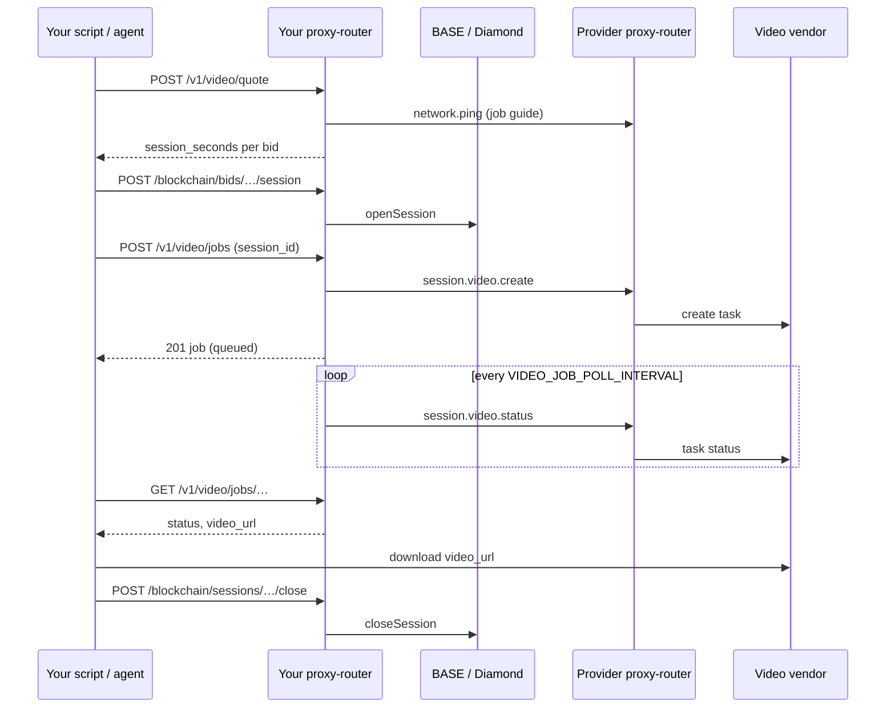

Video models turn a text prompt, and on some models a first-frame image, into a short MP4 clip. A clip takes minutes to render, so video is a **job**, not a chat request: you quote the job, open a session long enough to pay for it, submit the job on that session, and poll until the clip is ready. Independent providers run the jobs on hosted video vendors (BytePlus ModelArk, Renderful). Your node talks only to the provider, never to the vendor.

<Note>
Video jobs run through the proxy-router HTTP API on your own node (`http://localhost:8082`), or through the **Video** screen in MorpheusUI, which runs the same steps for you ([In MorpheusUI](#in-morpheusui)). The API gateway and the hosted Morpheus Inference API (`api.mor.org`) do not run video jobs.
</Note>



## In MorpheusUI

Open **Video** in the sidebar and pick a video model. The screen reads the model's limits from its providers and shows each provider's price for the clip as you change its length, resolution, aspect ratio, sound or first frame. Write the prompt and press **Open session & generate**: the app opens a session for exactly the quoted length on the provider you picked, after the usual confirmation window, and submits the clip on it. While the session has time left for another clip, **Generate in this session** submits the next one on the same session.

Clips appear under **Clips** as they render. Play a finished clip in the app or save the MP4. Close the session from the same screen when you are done. Video models do not appear in the Chat model picker.

## Find a video model

A video model carries a video tag on chain (`video`, `t2v`, `i2v`, `text-to-video`, `text2video`, `image-to-video` or `image2video`) and lists with `ModelType` `VIDEO` in `GET /blockchain/models`. A model that also carries an LLM, STT, TTS, embeddings or Decisions tag keeps that type instead of `VIDEO` (an LLM plus video row is a chat model). To see which video models have live bids, read the **ACTIVE** layer at [active.mor.org](https://active.mor.org) ([Marketplace catalog](/ecosystem/active-status)).

## Headers

| Header | Required | Purpose |
|--------|----------|---------|
| `Authorization: Basic <base64(user:pass)>` | Yes | Local proxy-router auth. Permission method for the `/v1/video/*` routes: **`video_jobs`**. See [API auth](/reference/api-auth). |
| `session_id` | Yes on `POST /v1/video/jobs` | The session you opened for the job. The node never opens a session for a video job. |
| `model_id` | Quote only, when the body has no `model` | On-chain model id to quote. |
| `Content-Type: application/json` | On `POST` | |

A scoped agent user needs `video_jobs`, plus `get_bids` for the stake estimate and `open_session` / `close_session` for the session.

## The job

`POST /v1/video/quote` and `POST /v1/video/jobs` take the same body. Only `prompt` is required. Omitted fields take the model's defaults from the provider's job guide.

| Field | Default | Notes |
|-------|---------|-------|
| `prompt` | — | Required. What the clip shows. At most 4000 bytes after surrounding whitespace is trimmed. |
| `duration_seconds` | `5` | Clip length in seconds, within the model's range (2 to 30 seconds, depending on the model). Changes the quote. |
| `aspect_ratio` | `16:9` | One of the ratios the model offers, from `16:9`, `9:16`, `1:1`, `4:3`, `3:4`, `21:9` and `adaptive`. With a first frame, BytePlus models and Renderful Seedance models keep the frame's own ratio whatever you send: the job's `resolved.aspect_ratio` then reads `adaptive`, while the quote's `resolved` still shows the ratio you sent. |
| `resolution` | `720p` | `480p`, `720p` or `1080p`, as the model offers. Changes the quote. |
| `generate_audio` | `false` | Generate a soundtrack. Only on models with an audio switch; `true` on another model is refused. |
| `image_url` | — | First frame (image-to-video) as a public `https` URL the vendor fetches. Only on models that accept a first frame. |
| `image_b64` | — | First frame sent inline, as plain base64 or a `data:` URI. JPEG, PNG or WebP, at most 10 MiB. Only on models that accept an inline image. Ignored when `image_url` is set. |
| `model` | — | Quote only: the on-chain model id. A submitted job uses its session's model. |

A value outside the model's limits gets an `error` entry in the quote and a `422` on submit. The quote's `resolved` object shows the job with the defaults applied.

## Quote the job

```bash
curl -X POST 'http://localhost:8082/v1/video/quote' \
  -H 'Content-Type: application/json' \
  -H 'Authorization: Basic <base64(user:pass)>' \
  -d '{
    "model": "0x<modelId>",
    "prompt": "A red fox runs through fresh snow at dawn, slow motion.",
    "duration_seconds": 5,
    "resolution": "720p"
  }'
```

```json
{
  "object": "list",
  "data": [
    {
      "provider": "0x…",
      "bid_id": "0x…",
      "price_per_second_wei": "…",
      "session_seconds": 844,
      "quote_seconds": 844,
      "session_cost_wei": "…",
      "resolved": {
        "prompt": "A red fox runs through fresh snow at dawn, slow motion.",
        "duration_seconds": 5,
        "aspect_ratio": "16:9",
        "resolution": "720p",
        "generate_audio": false,
        "has_image": false
      }
    },
    {
      "provider": "0x…",
      "bid_id": "0x…",
      "price_per_second_wei": "…",
      "error": "provider advertises no video guide for this model"
    }
  ]
}
```

- One entry per bid on the model, best-rated bid first.
- `session_seconds` is the session length that pays for this job with this provider, raised to the contract's minimum session length. `session_cost_wei` is `price_per_second_wei × session_seconds`.
- `quote_seconds` is what the job uses of a session. The provider adds these up against the session length when it takes a job. It equals `session_seconds` unless the contract minimum is longer than the job's quote.
- `error` means this provider cannot take the job: it did not answer, it runs a version without video jobs (`provider advertises no video guide for this model`), or the job is outside its model's limits.

The provider's job guide carries the quote formula. The current adapters all use:

```
session_seconds = ceil(duration_seconds × resolution weight × 75)
```

with weights `480p` 1, `720p` 2.25 and `1080p` 5 (audio and a first frame weigh 1). The result is at least 300 and at most 86400 seconds, and is raised to the contract's minimum session length. A job above the contract's maximum is refused. Examples: 5 s at `720p` is 844 s, 4 s at `480p` is 300 s, 5 s at `1080p` is 1875 s.

The MOR that the open locks (the stake) is a different, usually much larger number. Ask for it with the quoted length and bid:

```bash
curl 'http://localhost:8082/blockchain/models/<modelId>/session/estimate?sessionDuration=844&bidId=<bidId>' \
  -H 'Authorization: Basic <base64(user:pass)>'
```

`stake_wei` is what the contract locks. See [Estimate a session before opening](/reference/api-endpoints#estimate-a-session-before-opening).

## Open a session on the bid

Open on the `bid_id` from the quote, for `session_seconds`:

```bash
curl -X POST 'http://localhost:8082/blockchain/bids/<bidId>/session' \
  -H 'Content-Type: application/json' \
  -H 'Authorization: Basic <base64(user:pass)>' \
  -d '{"sessionDuration": 844}'
```

The response carries `sessionID`. Open on the bid rather than with `POST /blockchain/models/<modelId>/session`, which picks a bid itself. Other body fields (`directPayment`, `rejectExisting`): [Open session by bid ID](/reference/api-endpoints#open-session-by-bid-id). For several clips on one session, see [Several jobs on one session](#several-jobs-on-one-session).

## Submit the job

```bash
curl -X POST 'http://localhost:8082/v1/video/jobs' \
  -H 'Content-Type: application/json' \
  -H 'Authorization: Basic <base64(user:pass)>' \
  -H 'session_id: 0x<sessionId>' \
  -d '{
    "prompt": "A red fox runs through fresh snow at dawn, slow motion.",
    "duration_seconds": 5,
    "resolution": "720p"
  }'
```

Send the same fields you quoted: the provider prices the job again against the session, so a longer or sharper clip than quoted may not fit. The call returns `201` once the vendor accepted the task. That can take up to a minute, or about two minutes when the provider's answer does not arrive and your node sends the job once more. Give your HTTP client a timeout above that: a client that gives up does not cancel the job, and submitting again renders a second clip on the session. The response:

```json
{
  "object": "video.job",
  "id": "vjob_…",
  "model": "0x…",
  "status": "queued",
  "session_id": "0x…",
  "quote_seconds": 844,
  "vendor": "byteplus",
  "vendor_task_id": "…",
  "resolved": {
    "prompt": "A red fox runs through fresh snow at dawn, slow motion.",
    "duration_seconds": 5,
    "aspect_ratio": "16:9",
    "resolution": "720p",
    "generate_audio": false,
    "has_image": false
  },
  "error": null,
  "created_at": "2026-11-03T09:40:12Z",
  "updated_at": "2026-11-03T09:40:12Z"
}
```

A refused submit creates no job and leaves the session open: fix the request and submit again on the same session. The prompt and first frame travel to the provider like a chat prompt: signed, and encrypted to the provider's key when the provider supports prompt encryption. The provider's vendor key never leaves the provider.

## Poll for the clip

```bash
curl 'http://localhost:8082/v1/video/jobs/<jobId>' \
  -H 'Authorization: Basic <base64(user:pass)>'
```

`GET /v1/video/jobs` lists every job this node knows, newest first, as `{"object": "list", "data": [...]}`.

A `GET` reads your node's record of the job; it does not call the provider. Your node asks the provider for the status every `VIDEO_JOB_POLL_INTERVAL` (default 10 s), and backs off up to 2 minutes while the provider does not answer. Status reads still work after the session ended. Records survive a restart: the node resumes watching unfinished jobs, and keeps each record for 8 days after its last change.

When the job succeeded, the record carries the link:

```json
{
  "id": "vjob_…",
  "status": "succeeded",
  "video_url": "https://…",
  "expires_at": "2026-11-04T09:43:05Z",
  "error": null
}
```

Download the clip:

```bash
curl -L -o clip.mp4 '<video_url>'
```

<Warning>
`video_url` is the vendor's own link to the MP4. It is a bearer link: anyone who has it can download the clip until it expires. `expires_at` says when, if the vendor documents it: 24 hours after the render finished for `vendor` `byteplus`; `renderful` links carry no `expires_at`. Your node does not store or proxy the file, so save it before the link expires, and share the file rather than the link.
</Warning>

Your node refuses a relayed link that is not a public `https` URL: the job then ends `failed` with `invalid_video_url`.

## Close the session

Video jobs never close the session. You close it, once every job on it shows a final status:

```bash
curl -X POST 'http://localhost:8082/blockchain/sessions/<sessionId>/close' \
  -H 'Authorization: Basic <base64(user:pass)>' -d '{}'
```

- Unused time is refunded as for any session: unused stake returns in the close transaction, and the used stipend day-locks until the next UTC day. See [Sessions: stake, close, claim](/concepts/sessions-stake-close-recover).
- If you close **more than 60 seconds before the session's end**, a clip your node has not received yet is withheld: its job ends `cancelled` with `error.code` `session_closed_early`.
- A session that runs to its end is closed by your node's normal expiry auto-close, as for any session, so you need not close it yourself; clips that finish later are still delivered.
- A failed submit or a failed render leaves the session open.

## Several jobs on one session

A session pays for the jobs on it. The provider takes a job while the quotes of all jobs on the session, this one included, add up to no more than the session's length. For several clips, add up their `quote_seconds` and open for the total, or for the contract minimum if that is longer: two 5-second `720p` clips need 844 + 844 = 1688 seconds.

- Each job is quoted on its own, so the 300-second floor applies to each one.
- A job the vendor accepted counts against the session even when its render fails later.
- A job that no longer fits is refused with `422` before it reaches the vendor, for example `this job needs 844 seconds of session on top of the 844 seconds earlier jobs on it took, the session is 1200 seconds long`.
- Submit every job before the session ends: the provider refuses a submit on an expired or closed session.

## When the provider cannot be reached

If the provider does not answer the submit, or its answer is lost on the way back, `POST /v1/video/jobs` still returns `201`. The job is kept with `vendor_task_id` empty, and your node sends it again with the same job id. A provider that already took the job answers with the same receipt, so the clip is not rendered twice. `vendor_task_id` fills in once the provider confirms the job. Your node keeps the unsent request only in memory: after a restart it stops resending and asks for the status instead. If the provider never took the job, it answers that it has no such job, and after three such answers the job ends `failed` with `provider_refused`.

## Job statuses

| `status` | Meaning | Final |
|----------|---------|-------|
| `queued` | Waiting at the vendor, or not yet confirmed by the provider (`vendor_task_id` empty) | No |
| `running` | Rendering | No |
| `succeeded` | `video_url` is set | Yes |
| `failed` | The render failed, or your node gave up; see `error` | Yes |
| `expired` | The vendor task expired before it finished | Yes |
| `cancelled` | The vendor cancelled the task, or the session was closed early | Yes |

`error` is `{code, message}`. Codes your node sets:

| `error.code` | `status` | Meaning |
|--------------|----------|---------|
| `session_closed_early` | `cancelled` | The session was closed more than 60 s before its end, before the clip was delivered |
| `invalid_video_url` | `failed` | The relayed link was not a public `https` URL |
| `watch_timeout` | `failed` | No final status after `VIDEO_JOB_MAX_WATCH` (default 72 h) |
| `provider_refused` | `failed` | The provider kept answering that it has no such job |

Other codes and messages come from the vendor.

## Errors

| HTTP | When |
|------|------|
| `400` | Malformed JSON. On submit: no `prompt` or no `session_id`. On quote: no `model` (body or `model_id` header), or a malformed one |
| `404` | A job id, session or provider this node does not know |
| `422` | The provider refused the job; the message says why: outside the model's limits, no room left on the session, session closed or expired, the vendor refused the content, or the provider's vendor account cannot serve it now. A provider without video jobs answers `unknown method` |
| `502` | Your node could not send the job (for example a failed TEE attestation), or on quote could not read the model's bids or the contract's session bounds |
| `503` | Video jobs are not enabled on this node |

## Node settings

`VIDEO_JOB_POLL_INTERVAL` sets how often your node asks the provider for a running job's status, and `VIDEO_JOB_MAX_WATCH` how long it keeps asking before the job ends `failed` with `watch_timeout`. Defaults and limits: [Env: proxy-router → Video jobs](/reference/env-proxy-router#video-jobs-consumer).

## Provider setup (summary)

A provider serves a video model with a `models-config.json` row whose `apiType` is `byteplus-video` (BytePlus ModelArk) or `renderful` (Renderful), and registers the model on chain with a video tag. Details: [models-config.json](/reference/models-config). Health probe: [Model health](/providers/full/model-health).
