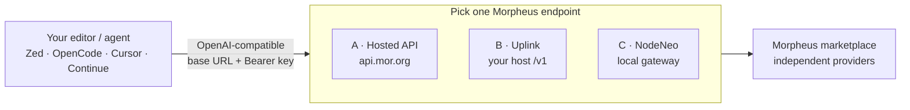

{/* Mintlify puts className on the tablist itself; default UI is underline text. */}
<style>{`
  ul.path-tabs,
  ul.editor-tabs {
    display: inline-flex;
    flex-wrap: wrap;
    width: auto;
    min-width: 0;
    max-width: 100%;
    gap: 0.35rem;
    margin-bottom: 1.25rem;
    padding: 0.35rem;
    border: 1px solid rgb(228 228 231);
    border-bottom: 1px solid rgb(228 228 231);
    border-radius: 0.75rem;
    background: rgb(244 244 245 / 0.85);
  }

  .dark ul.path-tabs,
  .dark ul.editor-tabs {
    border-color: rgb(63 63 70);
    background: rgb(39 39 42 / 0.9);
  }

  ul.path-tabs [data-component-part="tab-button"],
  ul.editor-tabs [data-component-part="tab-button"] {
    border: 0;
    border-bottom: 0;
    border-radius: 0.55rem;
    margin: 0;
    padding: 0.45rem 0.9rem;
    line-height: 1.25;
    color: rgb(82 82 91);
  }

  .dark ul.path-tabs [data-component-part="tab-button"],
  .dark ul.editor-tabs [data-component-part="tab-button"] {
    color: rgb(212 212 216);
  }

  ul.path-tabs [data-component-part="tab-button"][data-active="true"],
  ul.editor-tabs [data-component-part="tab-button"][data-active="true"] {
    background: rgb(22 163 74);
    color: white;
    box-shadow: 0 1px 2px rgb(0 0 0 / 0.18);
  }

  ul.path-tabs [data-component-part="tab-button"]:hover,
  ul.editor-tabs [data-component-part="tab-button"]:hover {
    border-color: transparent;
  }

  ul.path-tabs [data-component-part="tab-button"][data-active="false"]:hover,
  ul.editor-tabs [data-component-part="tab-button"][data-active="false"]:hover {
    background: rgb(228 228 231 / 0.85);
  }

  .dark ul.path-tabs [data-component-part="tab-button"][data-active="false"]:hover,
  .dark ul.editor-tabs [data-component-part="tab-button"][data-active="false"]:hover {
    background: rgb(63 63 70 / 0.85);
  }
`}</style>

You do not need Cursor's cloud models, Codex, or another locked-in assistant subscription to get AI help while you code. Morpheus speaks the same OpenAI-shaped HTTP those tools already understand. Pick an endpoint, paste a key, pick a model — and keep working in an editor you control.

This is the **base documentation** for that journey: which Morpheus brick to put behind your editor, how the pieces fit, and how to wire common clients. It is not how to run a provider or how to stake bids.

<Note>
**Where deep Path A how-tos live.** When you use only the shared hosted gateway (`api.mor.org`), per-tool walkthroughs for [Cursor](https://apidocs.mor.org/documentation/integrations/cursor) and [OpenCode](https://apidocs.mor.org/documentation/integrations/opencode) already exist on [apidocs.mor.org](https://apidocs.mor.org). This page owns the larger picture — including **Uplink** and **NodeNeo** — and links out to apidocs for hosted-only detail.
</Note>

## The bricks



Same client contract in all three cases:

1. **Base URL** — ends at `/v1` (or `/api/v1` for the hosted product)
2. **API key** — Bearer token for that product
3. **Model** — exact catalog string your endpoint accepts

Do **not** mix auth planes. A hosted `sk-…` from app.mor.org will not work on Uplink; an Uplink Prompt key will not work on `api.mor.org`; a raw C-Node Basic Auth cookie is a different surface again. Product boundaries: [Inference API overview](/inference-api/overview) vs [Companion gateway mode](/prosumers/companion-gateway-mode).

| You want… | Choose |
|-----------|--------|
| Coding help in under 10 minutes | **A — Hosted API** |
| Self-custody, your own MOR budget, no multi-tenant credits | **B — Uplink** |
| Desktop app that also exposes a local OpenAI URL for editors | **C — NodeNeo** (Mac TestFlight / Pro AI Gateway) |
| TEE-tagged models / attestation-aware routing | **B** or a [prosumer C-Node](/prosumers/overview) |
| Maximum marketplace surface (beyond GATEWAY) | Raw [C-Node](/prosumers/c-node-setup) + agents — not Path A |

Many developers start on **A**, then move the same editor config to **B** by changing only the base URL and key.

## Pick a path

<Tabs className="path-tabs" sync={false} borderBottom={false}>
  <Tab title="A · Hosted API" icon="cloud">
    No node. No wallet. Credits + an API key. This is the shared Morpheus API Gateway.

    | | |
    |--|--|
    | **Endpoint** | `https://api.mor.org/api/v1` |
    | **You pay with** | Credits on [app.mor.org](https://app.mor.org) |
    | **Ops burden** | None |
    | **Best when** | Fastest start; no wallet or node |

    <Steps>
      <Step title="Sign up">
        Create an account at [app.mor.org](https://app.mor.org) and log in.
      </Step>
      <Step title="Create an API key">
        Generate a key and confirm automation is enabled. Account walkthrough: [apidocs — setting up your account](https://apidocs.mor.org/documentation/guides/setting-up-your-account).
      </Step>
      <Step title="Confirm a model">
        Use a name from the hosted allowlist — not every bid on chain. Live GATEWAY input: [`gateway_models.json`](https://active.mor.org/gateway_models.json). Semantics: [Marketplace catalog](/ecosystem/active-status).
      </Step>
      <Step title="Point your editor">
        Base URL `https://api.mor.org/api/v1`, Bearer = your Morpheus API key, model = exact catalog string. Smoke-test with curl below, then use [Wire an editor](#wire-an-editor-any-path).
      </Step>
    </Steps>

    ```bash
    curl -sS https://api.mor.org/api/v1/models \
      -H "Authorization: Bearer $MORPHEUS_API_KEY"
    ```

    **Hosted-only deep dives (apidocs):**

    - [OpenCode integration](https://apidocs.mor.org/documentation/integrations/opencode) — full `opencode.json` + `/connect`
    - [Cursor integration](https://apidocs.mor.org/documentation/integrations/cursor) — BYOK base URL override
    - Product + SDK index: [apidocs.mor.org](https://apidocs.mor.org)
    - Summary on this site: [Inference API overview](/inference-api/overview)

    Path A does **not** teach Uplink or NodeNeo — use the other tabs for those.
  </Tab>

  <Tab title="B · Uplink" icon="server">
    Uplink is the opposite of the shared gateway: *your* OpenAI-compatible HTTPS front door, backed by *your* consumer proxy-router (C-Node) and *your* wallet. Sessions open and reuse automatically — coding tools never send a `session_id`.

    | | |
    |--|--|
    | **Endpoint** | `https://<your-host>/v1` |
    | **You pay with** | Your MOR (self-custody) |
    | **Ops burden** | You run the box |
    | **Best when** | Personal control, config, spend, and catalog policy |

    **Why developers pick Uplink for coding**

    - One stable `https://…/v1` for Zed, OpenCode, agents, and scripts
    - Spend is MOR from a wallet you fund and cap — not pooled multi-tenant credits
    - Prompt vs Master vs ephemeral keys so the IDE does not hold admin credentials
    - Probe + `GET /v1/models` so model strings stay honest
    - Same shape as Path A, so you can migrate by swapping URL + key

    **Stand it up**

    Prefer release assets over `git clone` for production. Overlays: SecretVM, generic VPS, or the in-repo Railway scaffold.

    | Step | Do this |
    |------|---------|
    | 1. Deploy | Follow [Uplink bootstrap](https://github.com/MorpheusAIs/Morpheus-Uplink/blob/main/docs/02-bootstrap.md) from the [latest release](https://github.com/MorpheusAIs/Morpheus-Uplink/releases/latest) |
    | 2. GUI | Open `https://<host>/gui/` with your admin password |
    | 3. Fund | Send a little **ETH** + **MOR** on Base to the wallet shown on Status |
    | 4. Probe | Run Probe once so you know a live model name |
    | 5. Key | Copy a **Prompt** or **ephemeral** `sk-…` (not Master) into your editor |

    | Setting | Value |
    |---------|--------|
    | Base URL | `https://<your-host>/v1` |
    | Auth | `Authorization: Bearer sk-prompt.…` (or ephemeral) |
    | Model | Exact name from Probe / `GET /v1/models` / [`gateway_models.json`](https://active.mor.org/gateway_models.json) |

    ```bash
    curl -sS https://YOUR_HOST/v1/models \
      -H "Authorization: Bearer sk-prompt.…"
    ```

    Operator docs (authoritative for install/GUI/keys):

    - [Morpheus-Uplink](https://github.com/MorpheusAIs/Morpheus-Uplink)
    - [Clients](https://github.com/MorpheusAIs/Morpheus-Uplink/blob/main/docs/04-clients.md)
    - [GUI / where is my MOR](https://github.com/MorpheusAIs/Morpheus-Uplink/blob/main/docs/03-gui.md)

    On this site (C-Node / companion side of the same stack):

    - [Companion gateway mode](/prosumers/companion-gateway-mode)
    - [C-Node setup](/prosumers/c-node-setup)
    - [Running local agents](/prosumers/running-local-agents)

    <Warning>
    Every Prompt / ephemeral key can open sessions and lock MOR from that gateway's wallet. Do not paste keys into untrusted agents or shared machines. Read the Uplink [DISCLAIMER](https://github.com/MorpheusAIs/Morpheus-Uplink/blob/main/DISCLAIMER.md).
    </Warning>
  </Tab>

  <Tab title="C · NodeNeo" icon="laptop">
    [NodeNeo](/ecosystem/nodeneo) is a consumer-side app on top of a Morpheus C-Node. On **Mac (Apple Silicon) with Pro**, it exposes a **local OpenAI-compatible AI Gateway** so editors and agents hit Morpheus through the app's wallet — same client contract as Paths A/B, against `localhost`.

    | | |
    |--|--|
    | **Endpoint** | Local OpenAI-shaped URL from the Mac app (AI Gateway) |
    | **You pay with** | Your MOR via the in-app C-Node / wallet |
    | **Ops burden** | App-managed |
    | **Best when** | You want phone + Mac self-custody, then point Zed / VS Code / agents at the local gateway |

    | Setting | Value |
    |---------|--------|
    | Base URL | Local URL shown in NodeNeo AI Gateway (OpenAI-shaped `/v1`) |
    | Auth | Key / credential the app issues for local clients |
    | Model | Exact name from the app's model list |

    **Status (from [nodeneo.ai](https://nodeneo.ai)):** iOS and Android are live; **macOS is in TestFlight** while App Store review completes. AI Gateway for tools (Zed, LangChain, etc.) is a Mac + Pro feature.

    - Install / TestFlight: [nodeneo.ai](https://nodeneo.ai)
    - Same editor steps as A/B once the local URL + key are copied — [Wire an editor](#wire-an-editor-any-path)
    - Desktop chat alternative without NodeNeo: [MorpheusUI consumer quickstart](/consumers/quickstart)
    - Headless agents against your own C-Node: [Prosumer overview](/prosumers/overview)
  </Tab>
</Tabs>

## Wire an editor (any path)

Any tool that supports a custom OpenAI base URL works. Swap only URL and key for the path you picked above.

<Tabs className="editor-tabs" sync={false} borderBottom={false}>
  <Tab title="Endpoint values" icon="plug">
    | Path | `api_url` / base URL | Key |
    |------|----------------------|-----|
    | A · Hosted | `https://api.mor.org/api/v1` | Hosted key from app.mor.org |
    | B · Uplink | `https://<your-host>/v1` | Uplink Prompt / ephemeral `sk-…` |
    | C · NodeNeo | Local gateway URL from NodeNeo | App-issued local key |
  </Tab>

  <Tab title="Zed" icon="code">
    [Zed](https://zed.dev) is open source and first-class for OpenAI-compatible gateways. Official docs: [Use API access](https://zed.dev/docs/ai/use-api-access).

    **UI path:** `agent: open settings` → LLM Providers → **Add Provider** → OpenAI-compatible. Fill provider name, API URL, model ID, context window. Paste the API key into the provider UI (keychain) — do **not** put secrets in `settings.json`.

    **Or in `settings.json` (Path A shown; change `api_url` for B/C):**

    ```json
    {
      "language_models": {
        "openai_compatible": {
          "morpheus": {
            "api_url": "https://api.mor.org/api/v1",
            "available_models": [
              {
                "name": "REPLACE_WITH_GATEWAY_MODEL_ID",
                "display_name": "Morpheus model",
                "max_tokens": 128000
              }
            ]
          }
        }
      }
    }
    ```

    Then set the key in Agent Settings, or export `MORPHEUS_API_KEY` (provider id `morpheus` → env `MORPHEUS_API_KEY`). For Uplink, set `api_url` to `https://<your-host>/v1`. For NodeNeo, use the localhost URL the app shows.

    Smoke-test with the curl for your path before debugging the editor.
  </Tab>

  <Tab title="VS Code" icon="brackets-curly">
    Stock VS Code has no first-party Morpheus panel — use an extension that speaks OpenAI-compatible HTTP. **Cline** is the most common agent path; **Continue** still works for chat/autocomplete.

    **Cline (recommended in VS Code)**

    1. Install the [Cline](https://cline.bot) extension.
    2. API Provider → **OpenAI Compatible**.
    3. Base URL → Path A `https://api.mor.org/api/v1`, or Uplink / NodeNeo `/v1` from Endpoint values.
    4. API Key → that path's key.
    5. Model ID → exact catalog string.

    **Continue** (`~/.continue/config.yaml`):

    ```yaml
    name: Morpheus
    version: 0.0.1
    schema: v1
    models:
      - name: Morpheus
        provider: openai
        model: REPLACE_WITH_GATEWAY_MODEL_ID
        apiBase: https://api.mor.org/api/v1
        apiKey: sk-your-key
    ```

    Swap `apiBase` / `apiKey` for Uplink or NodeNeo. Wrong model names fail resolve.
  </Tab>

  <Tab title="OpenCode" icon="terminal">
    Open-source coding agent (terminal / IDE / desktop). For **Path A**, use the complete guide on apidocs: [OpenCode integration](https://apidocs.mor.org/documentation/integrations/opencode) (`opencode.json` + `/connect`).

    For **Path B or C**, keep the same OpenCode provider shape but point `options.baseURL` at your Uplink or NodeNeo URL and `/connect` with that product's key. Model `name` keys must match what that endpoint lists.
  </Tab>

  <Tab title="Cursor" icon="mouse-pointer">
    You can keep Cursor as the shell and route inference through Morpheus. For **Path A**, follow [Cursor integration](https://apidocs.mor.org/documentation/integrations/cursor): add the model name → Morpheus API key → override OpenAI base URL to `https://api.mor.org/api/v1`.

    Paths **B/C** work the same pattern if Cursor accepts your custom base URL — paste the Uplink or NodeNeo URL and that product's key instead.

    <Note>
    Cursor's BYOK path may still proxy prompt assembly through Cursor's backend even when inference hits Morpheus. Prefer Zed, VS Code + Cline, or OpenCode if you want the client→endpoint path to stay direct.
    </Note>
  </Tab>

  <Tab title="Aider" icon="terminal">
    [Aider](https://aider.chat) is a terminal pair-programmer — good when you want git-aware edits without an IDE vendor lock-in.

    ```bash
    export OPENAI_API_BASE="https://api.mor.org/api/v1"
    export OPENAI_API_KEY="sk-your-key"
    aider --model openai/REPLACE_WITH_GATEWAY_MODEL_ID
    ```

    For Uplink / NodeNeo, point `OPENAI_API_BASE` at that host's `/v1`. The `openai/` prefix selects Aider's OpenAI protocol; the ID after the slash is what Morpheus receives.
  </Tab>

  <Tab title="Other" icon="boxes">
    Same three fields everywhere that supports a custom OpenAI base URL:

    1. Base URL → from Endpoint values
    2. API key → hosted / Uplink Prompt / NodeNeo local
    3. Model → **exact** string from that endpoint's catalog

    Also works with forks like **Roo Code** (Cline-shaped settings), JetBrains + Continue, and most LangChain / OpenAI SDK scripts. Wrong model names fail resolve. Never invent a flashy alias.
  </Tab>
</Tabs>

## Choosing models

| Endpoint | Catalog to trust |
|----------|------------------|
| Hosted API (A) / typical Uplink defaults (B) | **GATEWAY** — [`gateway_models.json`](https://active.mor.org/gateway_models.json) |
| NodeNeo (C) | Whatever the app surfaces (usually GATEWAY-aligned) |
| Raw C-Node browsing the whole market | Node `GET /blockchain/models` + health policy — not the GATEWAY file alone |

Explainer: [Marketplace catalog (ALL / ACTIVE / GATEWAY)](/ecosystem/active-status) · diagrams: [tech.mor.org/active.html](https://tech.mor.org/active.html).

For agent-heavy coding (tool calls, long refactors), prefer models that advertise tool / function calling (hosted [tool calling guide](https://apidocs.mor.org/documentation/guides/tool-calling) or Uplink Probe). Vision-only or TTS models are the wrong pick for an IDE agent.

## What you are getting out from under

| Centralized default | With Morpheus |
|---------------------|---------------|
| Editor vendor's model catalog and ToS | Marketplace providers; you pick the model string |
| Opaque cloud billing tied to the IDE | Credits (A) or self-custodied MOR (B / C) |
| One company's retention / training policy | Independent providers; TEE-tagged models when you need attestation ([TEE overview](/concepts/tee-overview)) |

You still choose the **editor**. Morpheus replaces the **inference vendor**, not the text editor.

## Common gotchas

| Symptom | Fix |
|---------|-----|
| 401 / verify fails | Wrong key for that brick (hosted ≠ Uplink `sk-…` ≠ C-Node Basic) |
| Model not found / resolve fails | Copy the ID from `GET /v1/models`, Probe, or `gateway_models.json` — case-sensitive |
| Zed 404 on chat | `api_url` must end at `/v1` (Zed appends the rest) |
| Agent tool errors | Some models lack OpenAI-style tools — pick another or disable tools in the client |
| Expecting every on-chain bid on Path A | Hosted allowlist ⊂ GATEWAY ⊂ ACTIVE ⊂ ALL |
| Uplink works in curl but not in the IDE | Confirm Prompt key (not Master-only admin Basic) and exact model string |
| Mixing `api.mor.org` with a local C-Node cookie | Different auth planes — pick one path |

## Related

- [Inference API overview](/inference-api/overview) — Path A product summary on this site  
- [apidocs.mor.org](https://apidocs.mor.org) — hosted API reference + Cursor / OpenCode how-tos  
- [Uplink](https://github.com/MorpheusAIs/Morpheus-Uplink) — Path B operator docs  
- [NodeNeo](/ecosystem/nodeneo) — Path C consumer surface  
- [Prosumer overview](/prosumers/overview) — C-Node + local agents  
- [Companion gateway mode](/prosumers/companion-gateway-mode) — session automation behind Uplink-class gateways  
- [Running local agents](/prosumers/running-local-agents) — auth scoping for automation  
- [Everclaw](/ecosystem/everclaw) — agent skill path against a C-Node  
